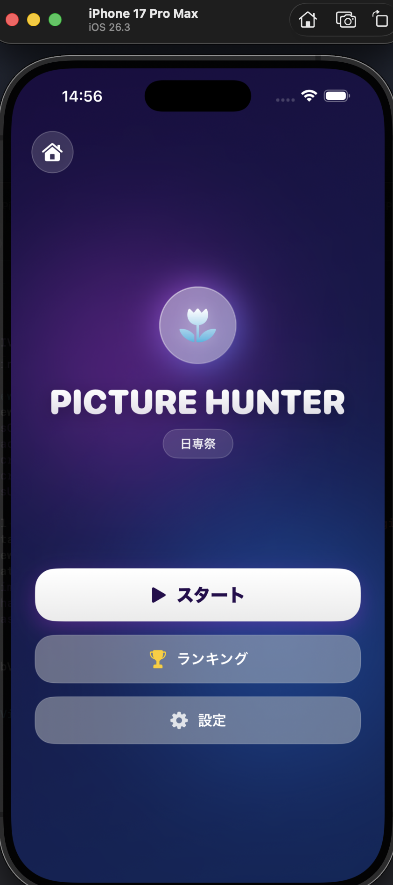
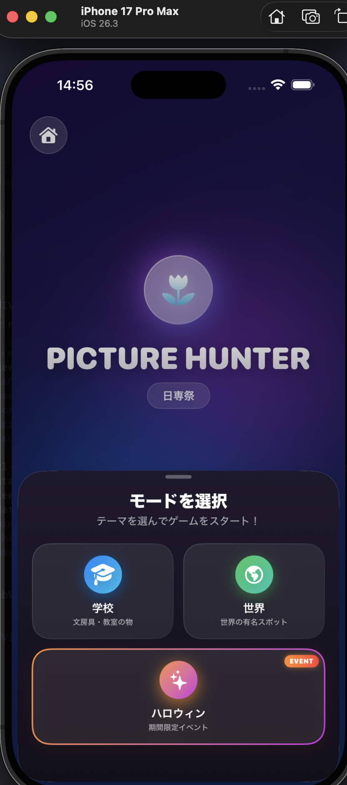
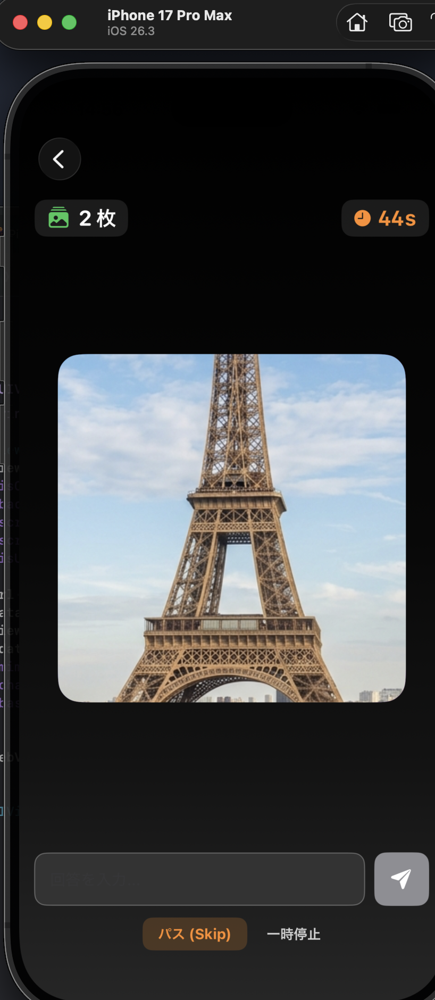
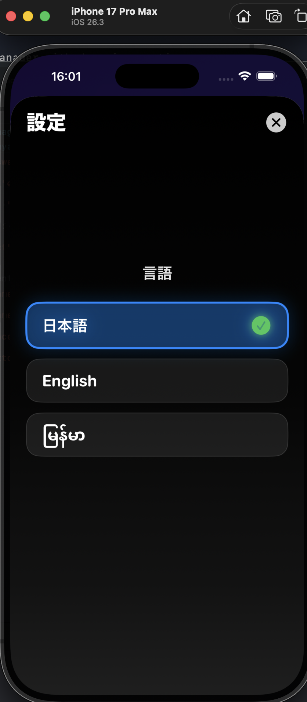

# 日専祭アプリ：ピクチャーハンター

> **チーム：** team footprint（26CM0102 アントワン アンドレオッティ、26CM0133 宮本彩月、26CM0137 ヤダナー ウー）
> **AI利用レベル ：** 2（生成コード可）
> **最終更新 ：** 2026-10-16

> 💡 制作の進め方は担任の先生から案内があります。このファイルの項目は、担任の先生の指示で増えることがあります。

---

## 何ができるアプリか（3行）

このアプリは、ズームされた「対象物」や「場所」の写真を見て、それが何かを当てるクイズゲームです。時間の経過とともに画像が徐々にズームアウトし、全体像が明かされていきます。タイムと正解速度に応じたスコアシステム・ランキング機能を搭載しており、日専祭の来場者が手軽に楽しめる体験型アプリです。

## 画面

## 使った文法・技術

- `@State` や `@Binding` を使った画面の切り替えとデータの受け渡し
- `Struct`（構造体）や `Array`（配列）を使った問題データやスコアの管理
- `@EnvironmentObject` や `ObservableObject` を使ったデータ管理（タイマー・言語設定）
- `Enum`（列挙型）を使った言語設定やゲームモードの切り替え

## 生成AIの使い方（どの場面で、どう使ったか）

- ゲームのスコア計算やタイマーの書き方が分からなかった時に、コードの例を教えてもらった。
- `SettingsView`（設定画面）のレイアウトをキレイにするアドバイスをもらった。
- エラーが出た時や Git で困った時に、解決方法を聞くために使った。

## 展示で工夫した点

（例：文字を大きくして、来場者が操作しやすいようにした。）
